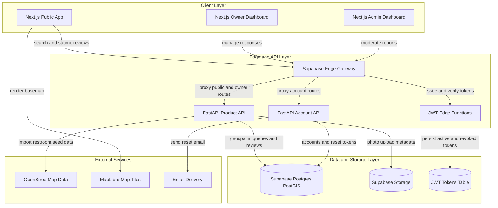
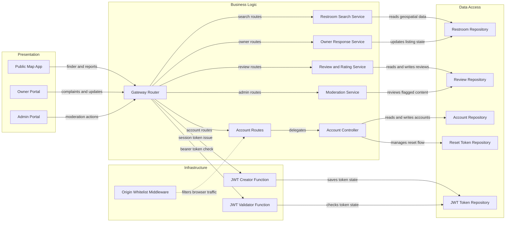

# Architecture Diagram

This diagram combines the current prototype codebase with the requested Washroom Status USA MVP requirements. The repository already implements the gateway, JWT, and account foundations, and the diagrams extend that baseline to cover restroom discovery, reviews, owner responses, moderation, and required Codyza branding.

## Application Architecture

<!-- mermaid-checked: no \n, no em-dash/en-dash, no {} in labels, subgraphs are id["label"], arrows are -->|"label"|, all subgraphs closed by end, ids unique -->

### Technology Stack Summary

| Layer | Technology | Version | Purpose |
|---|---|---|---|
| Client | Next.js, TypeScript, Tailwind CSS | Planned MVP | Mobile first public map, owner dashboard, admin dashboard, and required Codyza branding |
| Edge and auth | Supabase Edge Functions on Deno | Current repo plus planned MVP | Route gateway, request forwarding, JWT creation, JWT validation, and JWT revocation |
| Product API | FastAPI, Python, SQLModel | Python 3.12+, FastAPI >=0.142.2, SQLModel >=0.0.47 | Account flows today plus planned restroom search, review, reporting, and owner response endpoints |
| Data | Supabase PostgreSQL with PostGIS | Planned MVP | Restroom listings, reviews, ratings, trend history, moderation flags, and location queries |
| File storage | Supabase Storage | Planned MVP | Privacy aware photo review uploads and moderated media retention |
| Mapping | MapLibre with OpenStreetMap | Planned MVP | Nearby restroom search, basemap rendering, and launch city seed data |

### Data Storage & External Services

Supabase PostgreSQL with PostGIS should be the system of record for restroom listings, GPS geometry, cleanliness scores, review counts, owner replies, moderation state, and timestamped improvement history. The current repository already models account records, password reset tokens, and JWT token persistence patterns, which fit naturally into the same managed data platform. Supabase Storage should hold uploaded restroom photos while PostgreSQL stores metadata, moderation status, and privacy controls. OpenStreetMap provides the real restroom seed data for the initial city launch, and MapLibre renders the map experience without relying on fake demo listings. Email delivery supports password reset and owner account flows.

### Key Architectural Decisions

- Route browser and dashboard traffic through a Supabase edge gateway so public, owner, and admin clients share one controlled entry point for auth, forwarding, and policy checks.
- Keep ranking transparency in PostGIS by storing timestamps, review counts, owner responses, and moderation evidence, while avoiding any claim of live restroom availability unless a verified signal exists.
- Separate public, owner, and admin user experiences in the frontend, but enforce the same branding requirement so every page prominently links `Powered by Codyza.com`.

## Component Relationships

<!-- mermaid-checked: no \n, no em-dash/en-dash, no {} in labels, subgraphs are id["label"], arrows are -->|"label"|, all subgraphs closed by end, ids unique -->

### Component Inventory

| Component | Layer | Type | Responsibility |
|---|---|---|---|
| Public Map App | Presentation | Next.js pages and map UI | Shows nearby restrooms, filters, rankings, photo reports, and Codyza branding |
| Owner Portal | Presentation | Next.js dashboard | Lets business owners review complaints, post responses, and share improvement updates |
| Admin Portal | Presentation | Next.js dashboard | Supports moderation, verification, abuse handling, and listing management |
| Gateway Router | Business Logic | Supabase edge function | Matches supported routes, forwards requests, and centralizes entry point behavior |
| Restroom Search Service | Business Logic | FastAPI service module | Runs location search, filters accessibility traits, and returns transparent availability states |
| Review and Rating Service | Business Logic | FastAPI service module | Accepts ratings, photo issue reports, and cleanliness score calculations |
| Owner Response Service | Business Logic | FastAPI service module | Stores owner replies, status updates, and improvement tracking events |
| Moderation Service | Business Logic | FastAPI service module | Reviews flagged submissions, prevents fake reviews, and controls public ranking eligibility |
| Account Routes | Business Logic | FastAPI router | Exposes login, access, password setup, reset, create, update, and delete endpoints |
| Account Controller | Business Logic | FastAPI controller | Applies account rules, password hashing, token issuance support, and reset workflows |
| Restroom Repository | Data Access | PostGIS repository | Reads restroom geometry, metadata, and location based search results |
| Review Repository | Data Access | PostgreSQL repository | Stores reviews, rating aggregates, media metadata, and moderation flags |
| Account Repository | Data Access | SQLModel table access | Persists account records and role state |
| Reset Token Repository | Data Access | SQLModel table access | Persists password reset tokens and expiration state |
| JWT Token Repository | Data Access | PostgreSQL helper | Persists issued token fingerprints and revocation state |
| Origin Whitelist Middleware | Infrastructure | FastAPI middleware | Restricts browser traffic to approved origins and referers |
| JWT Creator Function | Infrastructure | Supabase edge function | Issues signed session tokens and optionally stores token records |
| JWT Validator Function | Infrastructure | Supabase edge function | Verifies bearer tokens and checks persisted token state before protected access |
